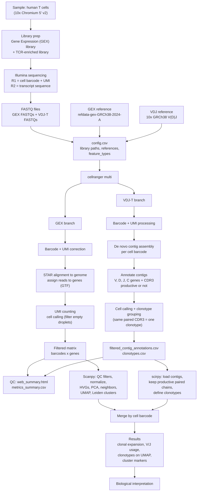

# Single-cell 5' GEX + TCR (V(D)J) Analysis with Cell Ranger `multi`

End-to-end workflow for processing 10x Genomics 5' single-cell gene expression and T-cell receptor (V(D)J) data, from FASTQs to clonotypes and clusters.

**Dataset:** Human T cells from a healthy donor, 1k cells, multi (v2), 10x Genomics (CC BY 4.0)
**Software:** Cell Ranger 9.0.1, Scanpy, scirpy
**References:** GRCh38-2024-A (GEX) and 10x VDJ reference for GRCh38

---

## Workflow overview



---

## Key concepts

| Term | Meaning |
|---|---|
| Cell barcode | Sequence that identifies the droplet (cell) a read came from |
| UMI | Unique tag per mRNA molecule; removes PCR duplicates |
| Contig | Full-length receptor chain assembled from short reads for one cell |
| CDR3 | Most variable junction region; the "fingerprint" of a receptor |
| Productive | Contig is in-frame, has no premature stop codon and is full length |
| Clonotype | Cells sharing the same paired CDR3 chains (descended from one T cell) |

The **cell barcode** links the expression matrix, clusters and clonotypes together.

---

## Repository structure

```
.
├── README.md
├── config/
│   └── multi_config.csv
├── scripts/
│   ├── run_cellranger_multi.sh
│   └── downstream_analysis.py
├── results/
│   ├── web_summary.html
│   ├── metrics_summary.csv
│   ├── clonotypes.csv
│   └── figures/
└── data/            # FASTQs and references are NOT committed (too large)
```

Add a `.gitignore` containing `data/`, `*.fastq.gz`, `*.bam`, `refdata-*/` and `T1k_run/SC_MULTI_CS/`.

---

## 1. Inputs

```bash
# Dataset (10x Genomics, Human T cells 1k, multi v2)
wget https://cf.10xgenomics.com/samples/cell-vdj/5.0.0/sc5p_v2_hs_T_1k_multi_5gex_t/sc5p_v2_hs_T_1k_multi_5gex_t_fastqs.tar
wget https://cf.10xgenomics.com/samples/cell-vdj/5.0.0/sc5p_v2_hs_T_1k_multi_5gex_t/sc5p_v2_hs_T_1k_multi_5gex_t_vdj_reference.tar.gz

# GEX reference (from the 10x support site)
wget https://cf.10xgenomics.com/supp/cell-exp/refdata-gex-GRCh38-2024-A.tar.gz

tar -xf  sc5p_v2_hs_T_1k_multi_5gex_t_fastqs.tar
mkdir vdj_ref && tar -xzf sc5p_v2_hs_T_1k_multi_5gex_t_vdj_reference.tar.gz -C vdj_ref
tar -xzf refdata-gex-GRCh38-2024-A.tar.gz
```

## 2. Config (`config/multi_config.csv`)

Use plain-text CSV with exact values (`Gene Expression`, `VDJ-T`) and absolute paths.

```
[gene-expression]
reference,/path/to/refdata-gex-GRCh38-2024-A
create-bam,false
expect-cells,1000

[vdj]
reference,/path/to/vdj_ref/vdj_reference

[libraries]
fastq_id,fastqs,lanes,feature_types
sc5p_v2_hs_T_1k_5gex,/path/to/sc5p_v2_hs_T_1k_5gex_fastqs,1|2,Gene Expression
sc5p_v2_hs_T_1k_t,/path/to/sc5p_v2_hs_T_1k_t_fastqs,1|2,VDJ-T
```

## 3. Run Cell Ranger

```bash
cellranger multi --id=T1k_run \
  --csv=config/multi_config.csv \
  --localcores=16 --localmem=64
```

Run time was about 15 minutes on a 16-core server.

## 4. Outputs

All under `T1k_run/outs/per_sample_outs/T1k_run/`:

| File | Content |
|---|---|
| `web_summary.html`, `metrics_summary.csv` | QC report and metrics |
| `count/sample_filtered_feature_bc_matrix/` | Cell x gene counts (cells only) |
| `count/analysis/` | PCA, UMAP, t-SNE, clustering |
| `count/sample_cloupe.cloupe` | Loupe Browser file |
| `vdj_t/filtered_contig_annotations.csv` | TCR contigs per cell (genes, CDR3, productive) |
| `vdj_t/clonotypes.csv` | Clonotype table with cell counts |
| `vdj_t/airr_rearrangement.tsv` | AIRR-format rearrangements |
| `vdj_t/vloupe.vloupe` | Loupe V(D)J Browser file |

## 5. Downstream analysis (Python)

```python
import scanpy as sc
import scirpy as ir

base = "T1k_run/outs/per_sample_outs/T1k_run"
adata = sc.read_10x_mtx(f"{base}/count/sample_filtered_feature_bc_matrix")
adata_tcr = ir.io.read_10x_vdj(f"{base}/vdj_t/filtered_contig_annotations.csv")

# Gene expression
adata.var["mt"] = adata.var_names.str.startswith("MT-")
sc.pp.calculate_qc_metrics(adata, qc_vars=["mt"], inplace=True)
sc.pp.filter_cells(adata, min_genes=200)
sc.pp.filter_genes(adata, min_cells=3)
adata = adata[adata.obs["pct_counts_mt"] < 10].copy()
sc.pp.normalize_total(adata, target_sum=1e4)
sc.pp.log1p(adata)
sc.pp.highly_variable_genes(adata, n_top_genes=2000)
sc.pp.pca(adata)
sc.pp.neighbors(adata)
sc.tl.umap(adata)
sc.tl.leiden(adata)

# TCR: merge by barcode, define clonotypes
ir.pp.merge_airr(adata, adata_tcr)      # older scirpy: ir.pp.merge_with_ir
ir.pp.ir_dist(adata)
ir.tl.define_clonotypes(adata)
ir.tl.clonotype_network(adata)
ir.pl.clonal_expansion(adata)
```

Function names in `scirpy` change between versions. Check the version you installed.

## 6. What to check in the QC report

- Estimated number of cells (about 1,000 expected)
- Median genes per cell and median UMI counts per cell
- Sequencing saturation and reads mapped to the transcriptome
- VDJ: cells with productive TRA and TRB, and mean reads per cell

---

## Notes

- Reads are aligned to the **genome** (STAR) and assigned to genes with the GTF annotation. VDJ reads are **assembled into contigs** and annotated against the V(D)J reference.
- `create-bam,false` saves a large amount of disk space.
- Different Cell Ranger and reference versions will give slightly different numbers from the published 10x web summary.

## Citation and data

- Data: 10x Genomics public dataset, "Human T cells from a Healthy Donor, 1k cells - multi (v2)", CC BY 4.0.
- Cell Ranger: 10x Genomics. Scanpy: Wolf et al., 2018. scirpy: Sturm et al., 2020.
